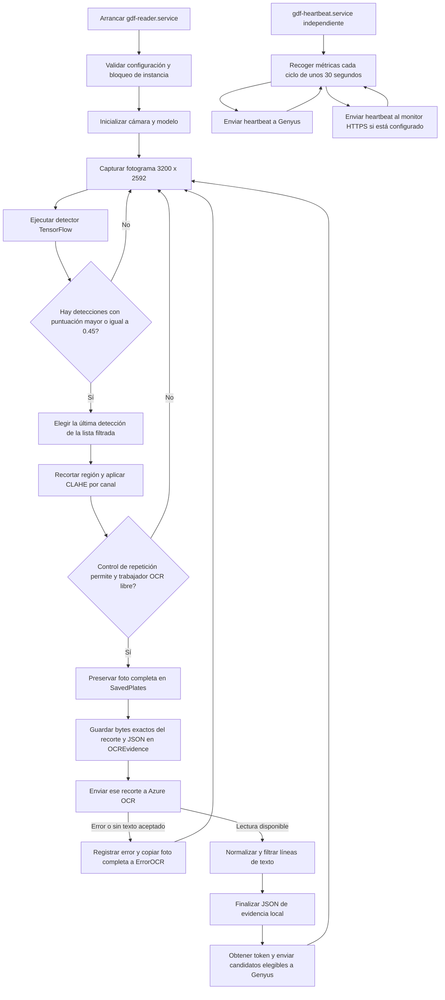

# LIPER / GSOTF — Funcionamiento de la aplicación

Versión de referencia: 18 de octubre de 2026. Documento basado en el código y en las comprobaciones del equipo Caucel4.

## 1. Qué hace

La Raspberry captura imágenes de la cámara, localiza posibles matrículas con un modelo TensorFlow y envía un recorte a Azure OCR. Después filtra el texto y envía las lecturas aceptadas a Genyus. Otro proceso independiente envía el estado de salud a Genyus y, si está configurado, al monitor web.

La detección de la región ocurre en la Raspberry. La lectura de los caracteres ocurre en Azure. Genyus recibe texto y datos del dispositivo; el flujo principal no le envía la fotografía.

## 2. Diagrama de flujo

El JSON de evidencia se finaliza antes de llamar a Genyus. La presencia de un candidato en ese JSON no demuestra que Genyus lo haya recibido.

El diagrama describe el recorrido lógico de un evento. El trabajador OCR se ejecuta en segundo plano: mientras espera la respuesta de Azure, el lector puede seguir capturando y detectando. No se acumulan nuevas solicitudes si ese trabajador está ocupado.

## 3. Cómo se decide una consulta al OCR

- El detector selecciona regiones con puntuación ≥ 0.45. Esa puntuación no es la precisión medida del sistema ni la confianza de Azure.
- De las regiones seleccionadas se utiliza únicamente la última de la lista; no necesariamente es la mejor ni la de mayor confianza. Es una decisión para limitar solicitudes.
- El recorte tiene un margen de aproximadamente cinco píxeles, se limita a los bordes de la imagen y recibe un ajuste de contraste CLAHE por canal.
- Un control por posición limita la repetición: movimiento de al menos 60 píxeles reinicia el contador; sin movimiento permite dos aceptaciones adicionales. Cinco segundos sin observación reinician el estado. No es seguimiento individual de vehículos ni deduplicación por matrícula.
- Hay un solo trabajo OCR activo. Si está ocupado, otro candidato no se acumula en una cola duradera. La captura y la detección pueden continuar.
- Una consulta puede devolver varias líneas. El código puede generar y enviar varios textos elegibles de esa misma respuesta; una sola solicitud OCR no garantiza un único envío a Genyus.

## 4. Qué se guarda y qué se envía

| Destino | Contenido | Observación |
|---|---|---|
| `SavedPlates/` | Fotografía completa del fotograma admitido al trabajador OCR | No se guardan aquí todos los fotogramas capturados |
| `ErrorOCR/` | Copia adicional de la foto completa si no hubo texto aceptado o falló el OCR | La foto puede permanecer en ambas carpetas; un fallo exclusivo de Genyus no activa por sí solo esta carpeta |
| `OCREvidence/` | Recorte JPEG exacto enviado y JSON asociado | Se usan los mismos bytes, sin recodificar para el envío; un fallo de escritura se registra y no bloquea el OCR |
| `TempImages/`, `PlateRegionImage/` | Imágenes temporales y regiones candidatas | Se limpian archivos antiguos, protegiendo los que están en uso |
| `Logs/runtime.log` | Eventos, errores y entregas registradas | Rotación de cinco respaldos de hasta unos 5 MiB, además del archivo activo |
| Azure OCR | Bytes del recorte | Requiere endpoint y clave de Azure |
| Genyus: detecciones | `plate`, `serie`, `side: "1"` | Ruta lógica `/MexGasStation` y servicio `/postPlateDetected`; no incluye foto ni hora de captura |

El JSON de evidencia incluye hora UTC de preparación del envío (`submitted_at_utc`), nombre de la foto completa, nombre y tamaño del recorte, SHA256, estado OCR, líneas originales, candidatos normalizados y candidatos elegibles para Genyus. No es una confirmación de entrega ni la hora exacta de exposición de la cámara. No guarda toda la respuesta detallada ni las confianzas de Azure en el flujo habitual.

La normalización elimina o ajusta algunos separadores y caracteres; el filtro exige números y ciertas condiciones de mayúsculas, estructura y longitud. Genyus solo se intenta para candidatos de 5 a 7 caracteres. Estos filtros no prueban que el objeto sea una matrícula: se observaron números de autobús aceptados como falsos positivos. El OCR también puede confundir caracteres de imágenes borrosas.

## 5. Heartbeat y monitor

`gdf-heartbeat.service` recoge temperatura, CPU, RAM, actividad de red y alerta de bajo voltaje. El heartbeat de Genyus utiliza el servicio lógico `/postLiperStatus`.

El segundo destino añade hora UTC, etiqueta del equipo y frescura del último fotograma procesado, tomada de `.health.json`. Los destinos se ejecutan de manera independiente: un fallo de uno no impide intentar el otro.

El monitor es de consulta pública; su escritura requiere token. No muestra placas, fotografías, claves ni el número de serie sin transformar. Se actualiza cada 10 segundos y considera desconectado un equipo que lleva más de 90 segundos sin señal. La salud del lector se marca reciente con una antigüedad de fotograma de hasta 30 segundos. Esto confirma actividad de captura/inferencia, no que una placa haya llegado a Genyus.

El nombre público procede de `GDF_HEALTH_LABEL`, configurado manualmente. El identificador del dispositivo se toma normalmente del número de serie del hardware. El código principal no manda una marca de tiempo de captura junto a la placa; no se ha verificado cómo Genyus asigna su propia hora.

## 6. Qué pasa si falla algo

| Situación | Comportamiento actual |
|---|---|
| Se cae Internet o falla Azure | Se conserva la foto del evento admitido; normalmente queda también en ErrorOCR. El recorte se conserva si la escritura de evidencia tuvo éxito. No se reprocesa automáticamente después |
| Azure leyó, pero falla Genyus | Se registra el fallo y quedan la evidencia y los candidatos locales. No existe una bandeja persistente de envíos pendientes |
| Genyus responde 429 | Hay reintentos acotados con espera; errores ambiguos de POST no se repiten automáticamente para evitar duplicados |
| Token rechazado 401/403 al enviar | El código puede solicitar un token nuevo y hacer un segundo intento |
| Falla un destino del heartbeat | Se registra; el otro destino sigue siendo independiente y el siguiente ciclo volverá a intentarse |
| Se cae el lector | systemd intenta reiniciarlo, con límites de frecuencia |
| Se reinicia la Raspberry | Los servicios habilitados vuelven a arrancar; no se recuperan trabajos OCR que solo estaban en memoria |
| Falta espacio | Puede fallar el guardado o el procesamiento. La retención automática de archivos archivados está desactivada y no hay una cuota automática activa |

La limpieza de temporales sigue funcionando. Es distinta de eliminar fotografías archivadas: `gdf-cleanup.timer` permanece deshabilitado por decisión del operador. No activar ese temporizador sin revisar su efecto y la conservación deseada.

## 7. Módulos principales

| Archivo | Responsabilidad |
|---|---|
| `MainPlateGSF.py` | Cámara, modelo, detecciones, selección del último recorte y salud del lector |
| `runtime.py` | Control de repetición, trabajador OCR único, protección y limpieza de temporales |
| `LiPER_NNP.py` | Azure OCR, normalización, autenticación y envío de textos a Genyus |
| `ocr_evidence.py` | Preservar bytes exactos y JSON de evidencia |
| `MainHBGSF.py`, `Send_HB.py` | Ciclo de heartbeat, métricas y dos destinos |
| `StartSettings.py` | Configuración XML, variables de entorno y serie del equipo |
| `HandlingEvents.py` | Logs rotativos y ocultamiento de secretos conocidos |
| `deploy/pi_installer.py` | Instalación, configuración, validaciones y diagnóstico |

## 8. Instalación activa y límites de la validación

En Caucel4 los servicios activos utilizan `/opt/gdf-test-reuse-20261018` y el entorno existente `/usr/bin/python3` del usuario `pi`. El nombre de la carpeta conserva el origen de la prueba, pero esa copia ya es la activa. La versión anterior permanece en `/home/pi/Desktop/GDF`.

Las carpetas `SavedPlates`, `ErrorOCR` y `OCREvidence` de la copia activa son enlaces a las carpetas anteriores para conservar el historial y evitar duplicar decenas de GB. Los temporales y logs de la nueva copia son propios.

Se comprobaron fotogramas recientes, ejecución del modelo, una consulta real a Azure y recepción de ambos heartbeats. La prueba OCR histórica confundió la Y inicial de `YU-1656-F` con V; la consulta funcionó, pero eso no valida la precisión del reconocimiento. No se enviaron placas históricas a Genyus durante esa prueba.

Pendientes: cola persistente para desconexiones, mejora de precisión, elección de mejor fotograma y validación completa de instalación con sistema limpio. GitHub Actions todavía no despliega automáticamente a la Raspberry.
