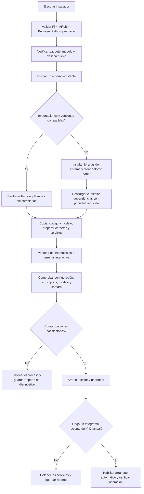

# LIPER / GSOTF — Instalación y puesta en marcha

Versión de referencia: 18 de octubre de 2026. Guía para un equipo nuevo; incluye una sección separada para consultar la Raspberry que ya está operando.

## 1. Requisitos y alcance probado

| Componente | Referencia |
|---|---|
| Equipo | Raspberry Pi 4 Model B, como Caucel4 |
| Sistema | Bullseye / Debian 11, 64 bits (`aarch64`) |
| Python | 3.9 |
| Cámara | IMX708 con enfoque automático, como la cámara existente |
| Espacio | El instalador exige al menos 8 GiB libres; reservar más espacio para las fotos de operación |
| Usuario | Usuario normal, por ejemplo `pi`, con acceso a sudo |
| Red | Necesaria para Azure, Genyus y el monitor; también para descargar dependencias si falta un entorno compatible |

El mismo modelo de Raspberry con otra versión de sistema operativo no garantiza compatibilidad. El instalador rechaza otras plataformas para evitar una instalación no validada. Tailscale y AnyDesk son opcionales para soporte remoto y se configuran aparte; no forman parte del procesamiento de matrículas.

**Estado de validación:** se probó la instalación reutilizando el entorno del equipo existente y se puso en operación esa copia. La instalación completa de dependencias en una tarjeta limpia sigue pendiente de certificar. El primer intento de crear el entorno descargó/descomprimió librerías grandes y degradó el acceso remoto; se detuvo. No prometer una duración fija para instalaciones nuevas.

## 2. Diagrama del instalador



Cada comando genera su reporte. La configuración y las comprobaciones previas pueden fallar antes del arranque. No es un actualizador de producción: rechaza el destino o unidades existentes. Si se reutiliza el entorno, se verifican importaciones y versiones de referencia, no basta con encontrar una carpeta.

## 3. Preparar el equipo nuevo

1. Instalar la imagen de sistema compatible, crear el usuario y configurar red y hora/NTP.
2. Conectar la cámara con el equipo apagado, según las indicaciones del fabricante, y arrancar.
3. Copiar `GDF_instalador_pi4.tar.gz` y su archivo `.sha256` a la misma carpeta de la Raspberry.
4. Tener disponibles el endpoint de Azure, la clave de Azure y la clave de Genyus autorizadas para ese equipo.

El paquete incluye código, modelo, etiquetas y scripts de instalación. No incluye credenciales ni fotos del equipo original. Los hashes comprueban integridad; verificar el checksum por una fuente de confianza, porque no sustituyen una firma del autor.

## 4. Instalar

Ejecutar desde la carpeta donde se copiaron el paquete y su checksum:

```bash
sha256sum -c GDF_instalador_pi4.tar.gz.sha256
tar -xzf GDF_instalador_pi4.tar.gz
cd gdf-installer
python3 deploy/pi_installer.py preflight
sudo python3 deploy/pi_installer.py install --user pi
```

Si el checksum falla, no continuar. Cambiar `pi` por el usuario real; no usar `root` como cuenta del servicio. El destino predeterminado es `/opt/gdf`.

El instalador busca primero un Python compatible en ubicaciones conocidas, incluidas `.venv` del paquete, `.venvs/gdf` del usuario, la instalación de escritorio GDF, `/opt/gdf/.venv` y `/usr/bin/python3`. Ejecuta la comprobación como el usuario del servicio para incluir sus librerías locales. Valida Python 3.9, TensorFlow 2.12, NumPy 1.23.5, protobuf 3.20 e importaciones de cámara, detección, OCR, heartbeat y ventana de configuración.

Si encuentra un entorno válido, lo reutiliza sin apt ni pip. Si no, instala dependencias y crea `.venv` con acceso a los paquetes del sistema necesarios para la cámara. Las versiones principales están fijadas, pero no hay un lock completo de todas las dependencias transitivas ni un paquete offline. Los pasos pip tienen prioridad reducida de CPU y disco; aun así pueden consumir tiempo y recursos.

Opciones útiles, para equipos nuevos o una prueba aislada:

| Opción | Uso |
|---|---|
| `--root /ruta/dedicada` | Cambiar destino; repetirlo en los comandos posteriores |
| `--python /ruta/al/python` | Validar y reutilizar un intérprete concreto; se detiene si no sirve |
| `--fresh-env` | Forzar un entorno nuevo |
| `--terminal` | Introducir claves en terminal en vez de ventana |
| `--skip-config` | Instalar y configurar las claves posteriormente |
| `--report-dir /ruta` | Elegir carpeta de reportes |
| `--isolated-test` | Prueba en directorio nuevo, con librerías del sistema existentes y sin registrar servicios ni ejecutar apt |

`--python` y `--fresh-env` son excluyentes. Una copia creada con `--isolated-test` no se puede arrancar mediante `start`: necesita una promoción controlada, como se hizo en Caucel4. No ejecutar instalaciones paralelas ni pruebas de cámara en un equipo operativo sin planificar la interrupción.

## 5. Introducir credenciales

Al finalizar la instalación aparece una ventana con estos campos:

| Campo | Dato requerido |
|---|---|
| Endpoint HTTPS de Azure OCR | URL base del recurso de Azure, sin claves ni parámetros |
| Clave de Azure OCR | Clave de acceso al recurso |
| Clave de Genyus | Clave autorizada para autenticarse y enviar lecturas/heartbeat |

Las claves aparecen ocultas. Pulsar **Guardar**. Si no hay escritorio accesible, se solicitan en una terminal interactiva. Cancelar deja el software instalado y la configuración pendiente; no arranca los servicios.

Para volver a abrir la configuración:

```bash
sudo python3 /opt/gdf/deploy/pi_installer.py configure
```

Se guarda en `/opt/gdf/Config.xml`, con permiso 600 y propiedad del usuario del servicio. No poner claves en argumentos de comandos, GitHub ni capturas de pantalla. El número de serie se obtiene automáticamente del hardware; la etiqueta pública del monitor es manual.

## 6. Configurar el monitor opcional

Editar localmente `/opt/gdf/runtime.env` y completar, si se quiere el segundo heartbeat:

```ini
GDF_HEALTH_URL=URL_HTTPS_DEL_RECEPTOR
GDF_HEALTH_TOKEN=TOKEN_DE_ESCRITURA
GDF_HEALTH_LABEL=NombreDelEquipo
```

Los valores anteriores son marcadores: sustituirlos por los autorizados. Conservar permiso 600 y propiedad del usuario del servicio. Es un archivo de entorno de systemd; no ejecutarlo con `source`. No cambiar el nombre del equipo original al preparar otro: asignar una etiqueta identificable a cada Raspberry. Si la URL queda vacía, el segundo destino está desactivado.

## 7. Comprobar y arrancar

En un equipo nuevo, con la cámara libre:

```bash
sudo python3 /opt/gdf/deploy/pi_installer.py check --hardware
sudo python3 /opt/gdf/deploy/pi_installer.py start
systemctl is-active gdf-reader.service gdf-heartbeat.service
```

`check --hardware` valida configuración y permisos, conexiones DNS/TLS, imports, carga e inferencia sintética del modelo y captura de cámara en memoria. No envía esa imagen al OCR ni a Genyus. DNS/TLS no confirma que las claves sean válidas. No ejecutar esta prueba mientras otro proceso use la cámara.

`start` repite las comprobaciones, inicia ambos servicios y espera hasta 180 segundos por un fotograma reciente del PID actual. Si falla el arranque, intenta detener ambos servicios. Tras la comprobación habilita el inicio automático. Si el equipo es más lento o tiene problemas, conservar el reporte y revisar la causa; no asumir que basta con esperar indefinidamente.

Después verificar:

- Fotogramas recientes en `.health.json`, con el PID del lector actual.
- Heartbeat recibido por cada destino configurado.
- Una lectura nueva con foto y evidencia; revisar la recepción real en Genyus cuando haya un vehículo.
- Temperatura, alimentación y espacio libre.

Un servicio «active», un heartbeat recibido o una autenticación correcta no demuestran por sí solos que una placa concreta haya llegado a Genyus. Las pruebas con fotos históricas deben separar OCR de envío, para no crear eventos históricos como si fueran nuevos.

## 8. Progreso, errores y reporte para soporte

El instalador muestra el paso al comenzar, el resultado y el tiempo. Durante los comandos largos controlados actualiza el tiempo cada 30 segundos. Algunas comprobaciones, como la búsqueda de entorno, muestran inicio y fin; no hay un porcentaje fiable de descarga.

En la carpeta de reportes, por defecto `gdf-reports/` desde el directorio de ejecución:

| Archivo | Uso |
|---|---|
| `installer-status.json` | Último paso, estado y tiempo registrado |
| `gdf-diagnostic-*.json` | Reporte de comprobaciones; la terminal indica `REPORT=...` |
| `/opt/gdf/installation.json` | Estado de instalación, usuario e intérprete seleccionado |

Para diagnóstico sin detener los servicios:

```bash
sudo python3 /opt/gdf/deploy/pi_installer.py diagnose
```

Compartir el archivo indicado por `REPORT=...`. Está diseñado para omitir claves, fotos, placas, IP, serie y logs crudos. Se crea con permiso 600 y no se envía automáticamente. Si se interrumpe el proceso bruscamente o falla el acceso al disco, puede no haber reporte final; conservar el último estado y el mensaje visible.

| Problema | Qué revisar |
|---|---|
| Plataforma incompatible | Pi 4, ARM64, Bullseye y Python 3.9 |
| Destino o servicio existente | No reinstalar encima de producción; revisar el destino y su respaldo |
| Paquete no disponible / conflicto | Código de etapa y categoría del reporte; versión del sistema y conexión a repositorios |
| Cámara ocupada | Otro lector, Thonny u otra aplicación puede estar utilizándola |
| Falta configuración | Ejecutar `configure` y completar los tres campos |
| Azure/Genyus no accesible | Red, DNS, hora del sistema y TLS; luego validar autenticación por separado |
| No aparece ventana | Usar una terminal interactiva y `configure --terminal` |
| Instalación lenta o SSH degradado | Revisar CPU, memoria, disco y red; evitar repetir descargas en paralelo y preferir un entorno compatible existente |

Para inspección local se puede usar `sudo journalctl -u gdf-reader.service -n 50`. Los logs pueden contener matrículas; no adjuntarlos sin revisar. No compartir `Config.xml`, `runtime.env` ni el TXT de credenciales como diagnóstico.

## 9. Consultar la Raspberry actual

En Caucel4 la carpeta activa es `/opt/gdf-test-reuse-20261018`, no `/opt/gdf`. Para diagnóstico de ese equipo:

```bash
sudo python3 /opt/gdf-test-reuse-20261018/deploy/pi_installer.py diagnose --root /opt/gdf-test-reuse-20261018
systemctl status gdf-reader.service gdf-heartbeat.service
```

No ejecutar `install` otra vez sobre este equipo. La promoción a producción se hizo con respaldo y verificaciones adicionales; el instalador empaquetado puede contener mejoras posteriores al script que quedó copiado en ese directorio. Las credenciales reales permanecen privadas y no forman parte de estos documentos.

## 10. Respaldo y reversión de Caucel4

Código anterior: `/home/pi/Desktop/GDF`. Respaldo del cambio: `/home/pi/backups/switch-installed-20261018`. Contiene unidades de servicio y `old-software.tar.gz` con código, modelo y configuración privada; no publicarlo. No es una imagen completa de la tarjeta ni un respaldo de todas las fotografías.

Solo si se decide revertir el cambio de este equipo, ejecutar:

```bash
sudo systemctl stop gdf-heartbeat.service gdf-reader.service
sudo cp /home/pi/backups/switch-installed-20261018/gdf-reader.service /etc/systemd/system/gdf-reader.service
sudo cp /home/pi/backups/switch-installed-20261018/gdf-heartbeat.service /etc/systemd/system/gdf-heartbeat.service
sudo systemctl daemon-reload
sudo systemctl start gdf-reader.service gdf-heartbeat.service
```

Esperar la carga del modelo y comprobar el estado y los fotogramas recientes en la carpeta anterior. No eliminar las carpetas de fotos: la nueva copia usa enlaces a ese historial. La limpieza automática permanece desactivada y los archivos temporales tienen una limpieza independiente.

## 11. Preparar un nuevo paquete desde el repositorio

```bash
python3 deploy/build_release.py --model-root /ruta/GDF --output GDF_instalador_pi4.tar.gz
```

`/ruta/GDF` debe contener `saved_model/` y `label_map.pbtxt`. El constructor usa una lista explícita de archivos e incluye un manifiesto SHA256; excluye configuración real, fotos y logs. Revisar siempre los archivos antes de publicar. El repositorio no debe incluir `credentials-local/`. El despliegue automático mediante GitHub Actions todavía no está conectado.
